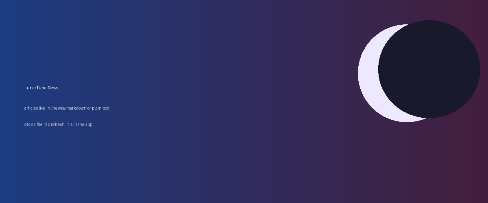

# News is live in the app

This is the first post in the new **News** feed. It is a plain markdown file in the
`news` folder of this repository, and the app reads it straight from there.

## Why a folder

Releases are for code. Writing a paragraph about a new player style should not need
a build, a tag and a download. So updates live here: commit a `.md` file, and anyone
with the app sees it the next time the feed refreshes.

- **Markdown** for anything with structure — headings, lists, tables, images.
- **Plain text** when you want the words exactly as typed.

## What it supports

| Element | Works |
|---|---|
| Headings and emphasis | yes |
| Lists and task lists | yes |
| Tables | yes |
| Images, including relative paths | yes |
| Links | yes |

Images are resolved against this folder, so `images/banner.png` above needs no
absolute URL anywhere.

> Posts are cached on the device after the first read, so news you have already
> opened keeps working offline — and a failed refresh never clears the list.

## What is next

This is the plumbing, not the design. The screen currently uses the same card and
type scale as the rest of the app; if the feed earns its keep, the next step is a
proper reading layout for long posts, and a small dot on the menu entry when there
is something new since your last visit.
